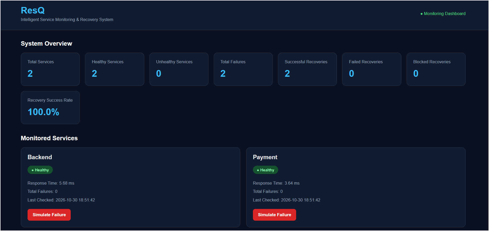
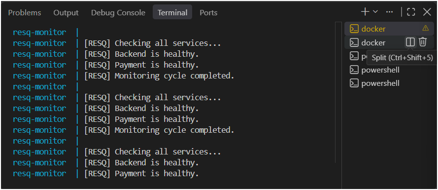
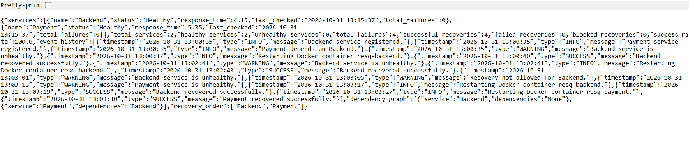

# ResQ – Intelligent Service Monitoring and Automatic Recovery System

ResQ is a microservice monitoring and automatic recovery system designed to detect service failures, monitor service health, and automatically restart failed Docker containers while considering service dependencies.

## Features

- Real-time health monitoring of microservices
- Automatic detection of service failures
- Automatic Docker container restart
- Dependency-aware recovery
- Recovery attempt limits and cooldown period
- Dashboard displaying service health and recovery statistics
- Failure simulation for testing
- Event history and monitoring logs
- REST API for dashboard data

## Technology Stack

- **Programming Language:** Python
- **Backend Framework:** FastAPI
- **Frontend:** HTML, CSS, JavaScript, Jinja2
- **Containerization:** Docker
- **Container Management:** Docker Compose
- **Testing:** Pytest
- **HTTP Requests:** Requests

## Project Structure

```text
ResQ/
│
├── main.py
├── service.py
├── backend_service.py
├── payment_service.py
├── simulation.py
├── requirements.txt
├── Dockerfile
├── docker-compose.yml
├── README.md
│
├── dashboard.png
├── recovery.png
├── api.png
│
├── monitoring/
│   ├── __init__.py
│   ├── monitor.py
│   └── health_checker.py
│
├── recovery/
│   ├── __init__.py
│   └── recovery_manager.py
│
├── dependency/
│   ├── __init__.py
│   └── dependency_graph.py
│
├── config/
│   └── settings.py
│
├── templates/
│   └── index.html
│
├── tests/
│   ├── test_recovery_manager.py
│   └── test_dependency_graph.py
│
└── logs/
```

## System Architecture

ResQ monitors two microservices:

- **Backend Service:** Runs on port 8001.
- **Payment Service:** Runs on port 8002.
- **ResQ Dashboard:** Runs on port 8000.
- **ResQ Monitor:** Continuously checks service health and performs recovery.

The Payment service depends on the Backend service. Therefore, ResQ considers the dependency order during recovery.

## How ResQ Works

1. ResQ periodically sends health-check requests to registered services.
2. If a service responds successfully, it is marked as Healthy.
3. If a service does not respond, ResQ marks it as Unhealthy.
4. ResQ checks the service dependency graph.
5. The recovery manager checks whether recovery is allowed.
6. ResQ restarts the failed Docker container.
7. ResQ checks the service health again.
8. The dashboard displays the updated service status and recovery events.

## Screenshots

### 1. ResQ Dashboard



### 2. Automatic Failure Recovery



### 3. Dashboard API Response



## Requirements

- Windows 10/11 or another operating system supporting Docker
- Python 3.12 or newer for local development
- Docker Desktop
- Docker Compose

## Installation and Execution

### Step 1: Clone the Repository

```bash
git clone https://github.com/ShreyasChavan-Dev/ResQ.git
cd ResQ
```

### Step 2: Build Docker Containers

```bash
docker compose build
```

### Step 3: Start ResQ

```bash
docker compose up -d
```

### Step 4: Check Running Containers

```bash
docker compose ps
```

The following containers should be running:

- resq-dashboard
- resq-backend
- resq-payment
- resq-monitor

### Step 5: Open the Dashboard

Open the following URL in your